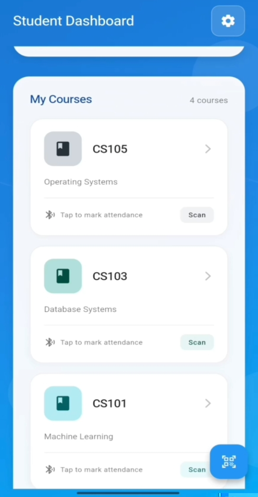
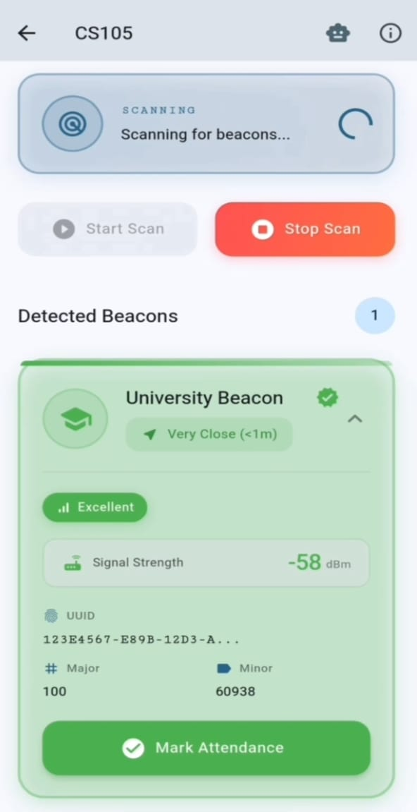
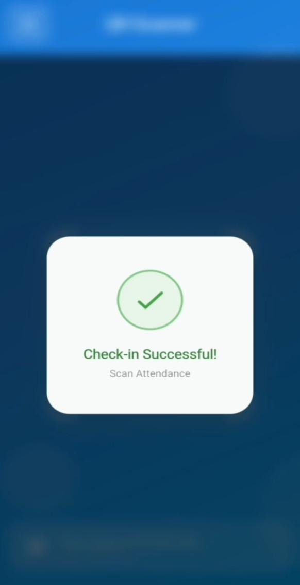
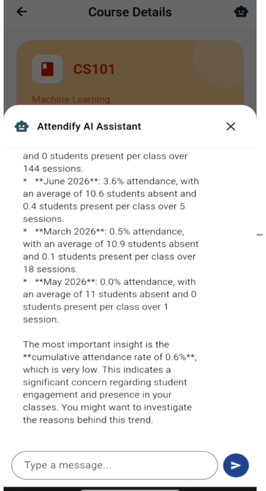
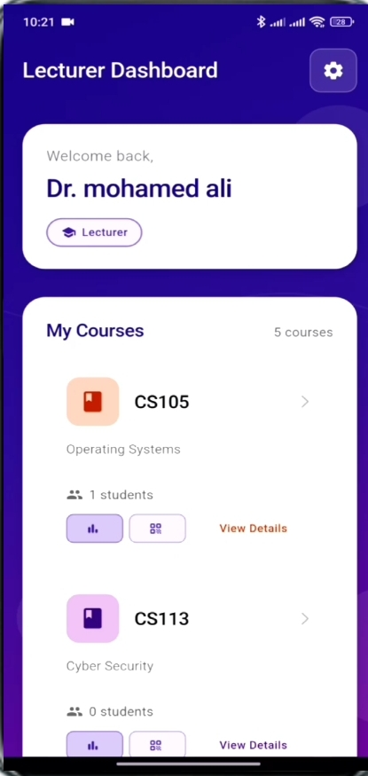
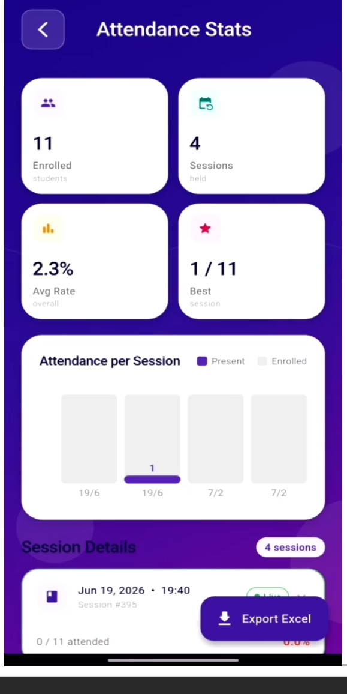
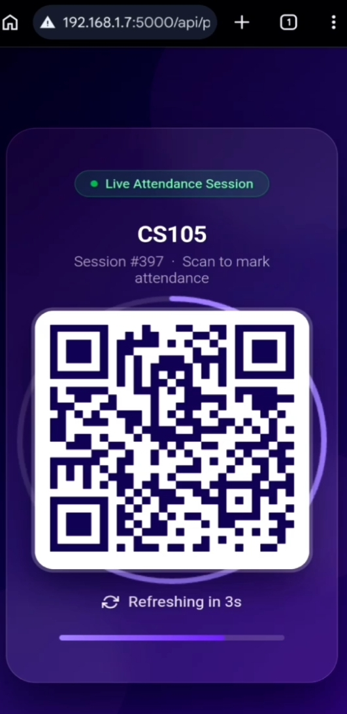
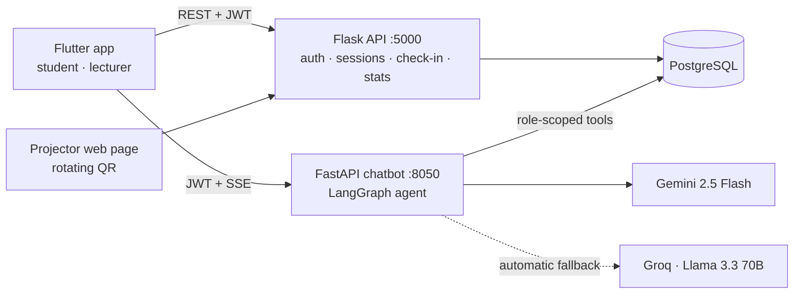
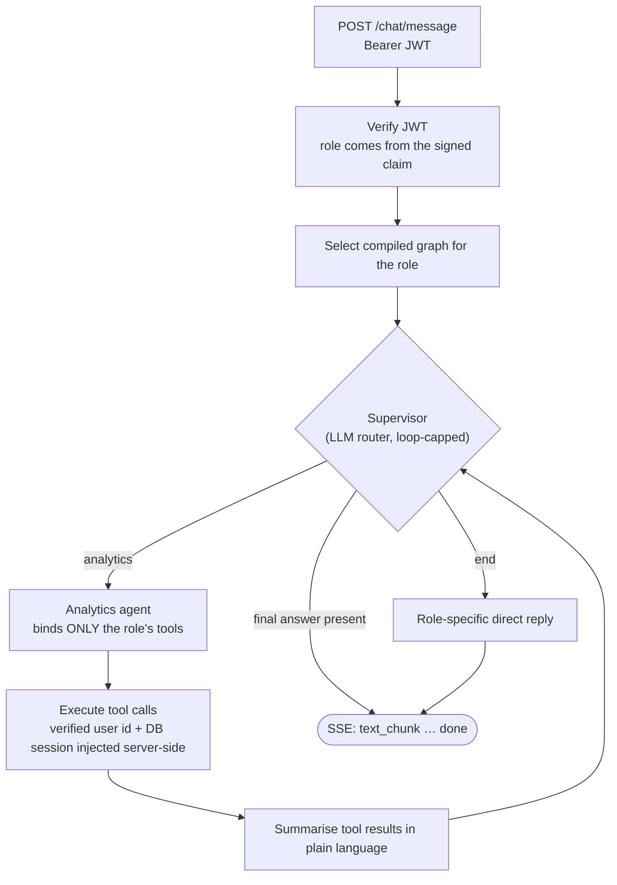

# Attendify

**A smart university attendance system with three check-in methods and an AI assistant that answers attendance questions in natural language.**


Attendify replaces paper roll-calls. A lecturer opens a session from their phone; students check in by **Bluetooth beacon proximity** or by scanning a **rotating QR code** shown on the classroom projector. Lecturers get live statistics and CSV export, and both students and lecturers can simply *ask* the built-in assistant ("What's my attendance in CS103?", "Who missed class on May 15th?").

> Graduation project.

## Screenshots

| Student dashboard | Beacon check-in | QR check-in | AI assistant |
|:-:|:-:|:-:|:-:|
|  |  |  |  |

| Lecturer dashboard | Session statistics | Projector QR |
|:-:|:-:|:-:|
|  |  |  |


---

## Features

**Check-in**
- **BLE iBeacon** – the lecturer's phone advertises a per-session beacon (UUID + major/minor); students' phones detect it and check in.
- **Dynamic QR (TOTP)** – a QR code that rotates every 5 seconds, shown on the classroom projector through a single-use, 60-second link.
- **Manual override** – lecturers can correct a record (also available through the chatbot).

**Anti-cheating (QR flow)**
| Check | Defends against |
|---|---|
| TOTP, 5 s step (±1 step tolerance) | Screenshots / forwarded QR codes |
| One device per attendance record (unique `(session, device)`) | One phone checking in several students |
| GPS geofence – 500 m around the faculty's coordinates | Checking in from home |
| Account ↔ device binding at login | Sharing an account across phones |
| One record per student per session (DB unique constraint) | Duplicates |

**Lecturer tools** – start / end sessions, per-session and per-course statistics, CSV export (opened as a spreadsheet in the app), projector link generation.

**Student tools** – enrolled-course list, check-in, personal attendance history.

**App** – Flutter (Android / iOS), English and Arabic UI, JWT stored in the platform's secure storage.

---

## Architecture



Three deployable parts share one PostgreSQL database and one JWT signing secret:

| Folder | What it is |
|---|---|
| [`Backend/`](Backend) | Flask REST API – authentication, sessions, check-in verification, statistics, Alembic migrations |
| [`chatbot serverside/`](chatbot%20serverside) | FastAPI + LangGraph assistant service |
| [`Frontend/`](Frontend) | Flutter mobile app |

---

## The AI assistant

The assistant answers questions about attendance by calling **database-backed tools**, not by guessing. It is deliberately *role-aware*: what it can do is decided by the signed JWT issued by the Flask API, never by anything typed in the chat.



### Design decisions

- **Tool sets are chosen by role, before the LLM sees anything.** A student's graph is compiled without the lecturer tools, so there is nothing for a prompt-injection to call. This is covered by a structural unit test.
- **Identity never comes from the model.** For every tool call the server overwrites `db_session`, `verified_user_id` and `verified_user_role` with values from the verified token, so an LLM-supplied student id is ignored.
- **Typed tool inputs.** Lecturer tools use strict Pydantic v2 schemas (`Literal["PRESENT","ABSENT"]`, `date`, integer ids).
- **Resilient LLM layer.** Gemini 2.5 Flash is primary; Groq-hosted Llama 3.3 70B is attached with LangChain's `with_fallbacks`, so a quota error or outage on one provider doesn't break the chat.
- **Runaway-loop protection.** The supervisor stops after `AGENT_MAX_ITERATIONS` (default 12).
- **Streaming.** Responses are delivered as Server-Sent Events (`text_chunk` per completed assistant message, then `done`); intermediate tool calls and raw tool output are never sent to the client.
- **Observability.** Structured logs via `structlog`; optional LangSmith tracing.

### Tools

| Tool | Student | Lecturer / Admin |
|---|:-:|:-:|
| `fetch_student_attendance_percentage(course_id)` | ✅ | ✅ |
| `get_my_attendance_history(course_id)` | ✅ | ✅ |
| `get_class_analytics(course_id)` – monthly rates & trends | | ✅ |
| `get_absentee_report(course_id, session_date)` | | ✅ |
| `override_attendance(student_id, course_id, session_date, new_status)` | | ✅ |

### Example questions

- *Student:* "What's my attendance percentage?" · "Show my attendance history for this course."
- *Lecturer:* "Give me the attendance trend for this course." · "Who missed class on 2026-05-15?" · "Mark student 42 present for 2026-05-15."

### Chatbot API

| Method | Path | Description |
|---|---|---|
| `POST` | `/api/v1/chat/init` | Start a conversation, returns `session_id` and the capabilities for your role |
| `POST` | `/api/v1/chat/message` | Send `{session_id, message, course_context?}`; response is an SSE stream |
| `GET` | `/health` | Liveness + database connectivity |

---

## Tech stack

| Layer | Technology |
|---|---|
| Mobile | Flutter, `flutter_beacon`, `beacon_broadcast`, `mobile_scanner`, `qr_flutter`, `geolocator`, `flutter_secure_storage` |
| REST API | Flask 3, Flask-JWT-Extended, SQLAlchemy 2, Alembic, Pydantic v2, `pyotp`, `haversine` |
| Chatbot | FastAPI, LangGraph, LangChain, Gemini 2.5 Flash, Groq (Llama 3.3 70B), async SQLAlchemy + asyncpg, structlog |
| Database | PostgreSQL (tested on Neon) |

---

## Getting started

### Prerequisites
Python 3.12, Flutter SDK, a PostgreSQL database with SSL (e.g. a free [Neon](https://neon.tech) project), a [Google AI Studio](https://aistudio.google.com) key and a [Groq](https://console.groq.com) key. BLE features need a **physical Android/iOS device**.

### 1. Flask backend
```bash
cd Backend
python -m venv .venv && source .venv/bin/activate      # Windows: .venv\Scripts\activate
pip install -r requirements.txt
cp .env.example .env                                    # fill in DATABASE_URL, secrets
flask --app run db upgrade                              # create tables
python run.py                                           # http://localhost:5000
```

### 2. Seed data
There is no admin UI yet, so create a faculty, a course and enrollments with SQL (after registering a lecturer and a student from the app):

```sql
INSERT INTO faculties (name, latitude, longitude)
VALUES ('My Faculty', 30.0444, 31.2357);              -- replace with your campus coordinates

INSERT INTO courses (title, description, lecturer_id, faculty_id)
VALUES ('CS101', 'Intro to Programming', <lecturer_user_id>, 1);

INSERT INTO enrollments (course_id, student_id) VALUES (1, <student_user_id>);
```

### 3. Chatbot service
```bash
cd "chatbot serverside"
python -m venv .venv && source .venv/bin/activate
pip install -r requirements.txt
cp .env.example .env     # JWT_SECRET_KEY MUST equal the Flask one
uvicorn app.main:app --port 8050 --reload
```

### 4. Flutter app
Set your machine's address in `Frontend/lib/services/api_service.dart` (`baseUrl`, port 5000) and `Frontend/lib/services/chat_service.dart` (`baseUrl`, port 8050), then:

```bash
cd Frontend
flutter pub get
flutter run
```
Use `10.0.2.2` for the Android emulator or your LAN IP for a real device.

---

## Flask API overview

| Method | Path | Role | Purpose |
|---|---|---|---|
| `POST` | `/auth/register`, `/auth/login` | – | Account creation / login (login binds the device) |
| `GET` | `/auth/me`, `/auth/courses/enrolled`, `/auth/courses/teaching`, `/auth/courses/<id>` | any | Profile and courses |
| `POST` | `/api/sessions/start`, `/api/sessions/end` | lecturer | Open / close a class session (returns beacon config) |
| `POST` | `/api/attendance/mark` | student | BLE check-in |
| `POST` | `/api/verify_qr` | student | QR check-in (TOTP → device → geofence) |
| `POST` | `/api/session/projector_token` | lecturer | Single-use, 60 s projector link |
| `GET` | `/api/attendance/stats/<course_id>` | lecturer | Per-session and overall statistics |
| `GET` | `/api/attendance/export/<course_id>/csv` | lecturer | CSV export (filter by session / date range) |

---

## Tests

Chatbot (from `chatbot serverside/`):

```bash
pytest tests/test_routing.py tests/test_tools.py tests/test_individual_tools.py -v --asyncio-mode=auto
```
`tests/test_injection.py` sends prompts through the live model, so it needs valid API keys and a reachable database.

---

## Known limitations & roadmap

- Conversation memory uses LangGraph's in-process `MemorySaver`; moving to the Postgres checkpointer would allow multiple workers and survive restarts.
- Streaming is per completed message rather than per token.
- The router currently has a single worker agent; a natural next step is a second one (e.g. RAG over the university's attendance policy) plus an evaluation set for routing and tool-selection accuracy.
- Attendance overrides are confirmed through the prompt; a hard human-in-the-loop confirmation step is planned.
- BLE check-in relies on physical proximity; the device and geofence checks currently apply to the QR flow only.
- No admin UI or seed script yet; no CI pipeline.

---

## Author

**<Your Name>** – AI Engineer · [LinkedIn](https://linkedin.com/in/your-handle) · [GitHub](https://github.com/your-username)
